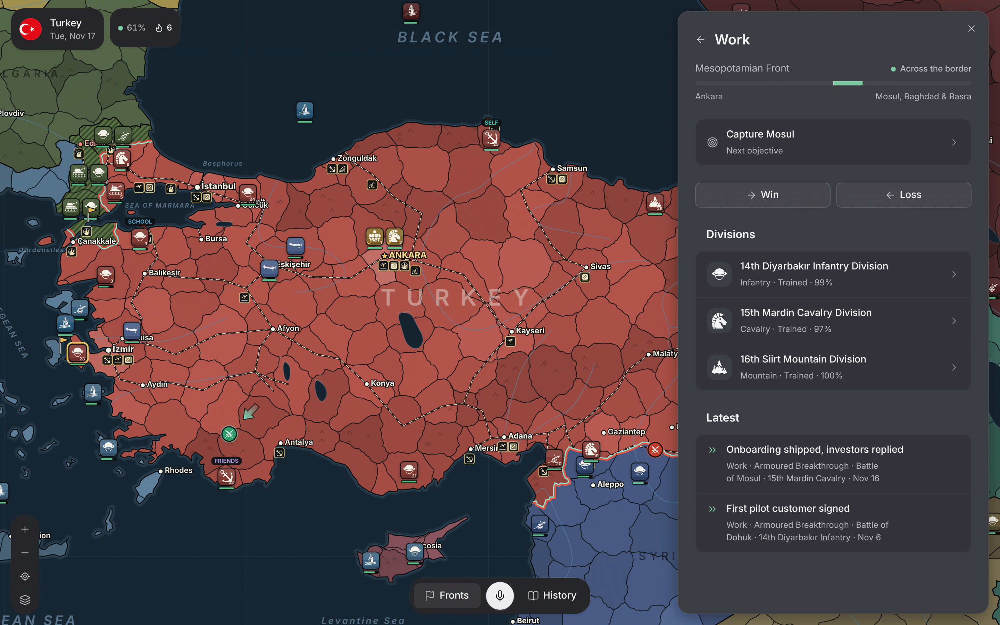
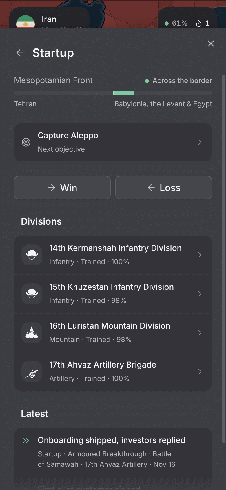
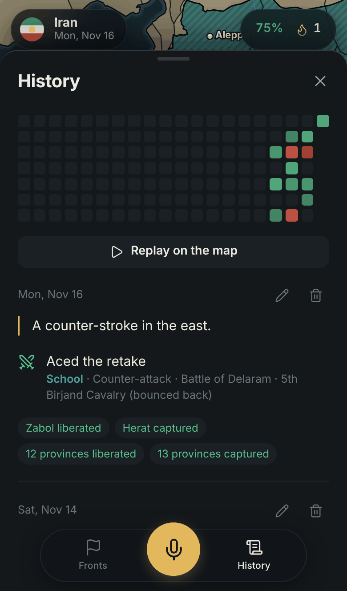
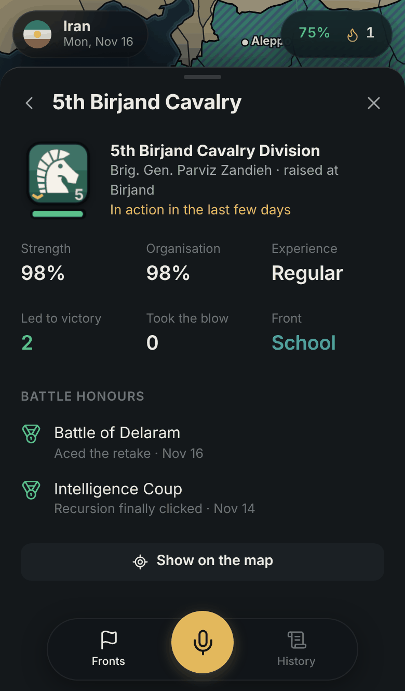

<h1 align="center">Home Front</h1>

<p align="center">
  <b>A self-hosted life tracker and journal, drawn as a 1936 grand-strategy war map.</b><br>
  Say what happened today. An AI general staff judges it, and the front lines of your life move.
</p>

<p align="center">
  <a href="https://sam-siavoshian.github.io/hoi4-irl/"><b>Try the demo</b></a> ·
  <a href="#quickstart">Quickstart</a> ·
  <a href="docs/SELF_HOSTING.md">Self-hosting</a> ·
  <a href="docs/API.md">API</a> ·
  <a href="docs/FAQ.md">FAQ</a>
</p>

<p align="center">
  <a href="https://github.com/sam-siavoshian/hoi4-irl/actions/workflows/ci.yml"></a>
  <a href="LICENSE"></a>
  
  
  
</p>

<p align="center">
  
</p>

## What it is

Home Front is a personal tracker for people who give up on habit trackers. You pick a country. It sits in
the middle of a 1936 map, and each of its seven border fronts stands for one area of your life: school,
family, work, health, friends. Once a day you say or type what happened, in your own words. A language
model acting as your general staff decides which front each event belongs to, whether it was a win or a
loss, and how big. Then the map reacts: fronts advance or collapse province by province, named divisions
fight and earn honours, ports are bombed and rebuilt.

Do well for long enough and the country's historical empire is restored. Let things slide and the enemy
reaches the capital. It is a diary with consequences, not a game: nothing moves unless you report
something real.

- **Private by design.** One user, one password, your own machine. Your API key never reaches the browser.
- **Works with any model, or none.** OpenAI, Ollama, LM Studio, OpenRouter, Groq, or the built-in offline judge.
- **Phone first.** Installs to the iPhone or Android home screen as a PWA and works offline.
- **Open source.** MIT licensed. The engine and server have no runtime dependencies.

<p align="center">
  
  
  
  
  
</p>

## Eight countries

Each has its own map, army, navy, air force, commanders, ranks and decorations, and an empire to restore.
Change country at any time; each keeps its own campaign.

| Country | Year | Borders to restore | Fronts |
|---|---|---|---|
| Iran | 1936 | Achaemenid Empire | 6 land, 1 naval |
| Turkey | 1936 | Ottoman Empire | 5 land, 2 naval |
| Greece | 1936 | Byzantine Empire of Basil II | 3 land, 4 naval |
| France | 1936 | First French Empire (1812) | 5 land, 2 naval |
| Ethiopia | 1935 | Aksumite Empire | 7 land |
| Siam | 1936 | Greater Siam | 5 land, 2 naval |
| Peru | 1936 | Tawantinsuyu | 6 land, 1 naval |
| Mexico | 1936 | Mexican Empire (1821) | 4 land, 3 naval |

<p align="center">
  
</p>

Want another one? A country is a single file: see [docs/SCENARIOS.md](docs/SCENARIOS.md).

## Why

Most trackers ask you to fill in forms: tick the habit, rate the day, pick a tag. That is work, so you
stop doing it.

Home Front asks for one thing: tell it what happened, in your own words, once a day. "Aced the chemistry
midterm, skipped the gym again, had a fight with my brother." Everything else is derived. The judge
sorts each event to the right front, decides whether it was a win or a loss and how big, and picks a
battle type that matches the cause. A week of flu is a blizzard that closes the passes. Sleeping
through an exam after scrolling all night is sabotage. A friend's introduction to an investor is allied
aid arriving.

The result is a picture you can read in two seconds. One front deep in enemy territory, another with
the enemy forty kilometres from the capital. You do not need a chart to know which part of your life
needs you this week.

## Features

**Reporting**

- Speak or type; one Send button. The staff splits a report into events, assigns fronts, dates them
  ("yesterday I...") and applies them. Undo is one tap. If it cannot tell where something belongs, it
  asks one question.
- One-tap Win / Loss on any front for days when you do not feel like writing.
- "Ask the staff": ask questions about your own history ("how has school gone since September?").

**The map**

- Seven fronts around your country, each advancing or retreating province by province, with real
  cities as objectives.
- Battle types that follow from what happened: nearly thirty of them, from Armoured Breakthrough to Desertions,
  each tied to a real-life meaning. The judge states the reason first and only then picks the type.
- Named divisions that lead battles according to their arm (armour breaks through, cavalry
  counter-attacks, artillery holds the line), gain experience, earn battle honours and nicknames, or take
  the losses.
- Geography that is respected: ports are struck only where there is a port, fleets fight only where there
  is sea. Weather follows the calendar. Three wins in a row launch a named operation; a front you stop
  reporting on lets the enemy mass.
- Regions restored under their historical names (satrapies, themes, eyalets, suyus), railways, repairs,
  new divisions and commanders, all run by the engine.

**Progress**

- Commander XP and ranks, three small "orders of the day", combos for reporting several fronts in one
  day, 30+ decorations and a weekly recap.
- History with a calendar, every entry editable or deletable, and a replay of the whole war.
- Shareable images: a daily bulletin card, a newspaper front page for big events, a weekly recap card.
- Optional sound effects, confetti, screen shake, haptics and number roll-ups. All of it can be turned
  off, and it respects the system's reduced-motion setting.

**Making it yours**

- Persona presets on first run (Student, Founder, Athlete, Creator, Parent and more) name the fronts for
  you. Everything can be renamed, and any front can be paused.
- OpenAI by default, or any OpenAI-compatible endpoint: Ollama, LM Studio, OpenRouter, Groq. With no key
  at all, an offline keyword judge keeps the app working.

**Running it**

- One Node server with no runtime dependencies. Also ships as a small Docker image.
- Password wall, API key kept on the host, `noindex` everywhere.
- Installs to the iPhone Home Screen and opens offline.
- A token-authenticated HTTP API and a small CLI, so iOS Shortcuts, Siri or a cron job can file a report.
- An append-only journal of every change and daily backups.

## Quickstart

You need Node 20 or newer.

```bash
git clone https://github.com/sam-siavoshian/hoi4-irl.git homefront
cd homefront
npm install               # the build tools for the interface
cp .env.example .env      # set HOMEFRONT_PASSWORD; add OPENAI_API_KEY if you have one
npm start                 # builds the interface into dist/ if needed, then http://localhost:8080
```

Open the address, type the password, pick a country and a persona, and file your first report.

With Docker:

```bash
cp .env.example .env      # set HOMEFRONT_PASSWORD
docker compose up -d      # http://localhost:8080, data in the homefront-data volume
```

No API key? Leave `OPENAI_API_KEY` empty. The offline keyword judge takes over, and you can add a key
or a local model later without losing anything.

Just want to look? Try the [offline demo](https://sam-siavoshian.github.io/hoi4-irl/).

## How it works

```
  you                    general staff                   engine                  map
  ───                    ─────────────                   ──────                  ───
  "aced the midterm,     for each event:                 replays every report    fronts move,
   skipped the gym"  →   front · win/loss · size 1-5  →  from the first one   →  divisions fight,
                         reason → battle type            deterministically       cities change hands
```

1. **Report.** You speak or type. Voice is transcribed on your server.
2. **Judge.** The server sends your text, the current situation and a strict JSON schema to the model.
   The model returns one item per event: which front, win or loss, a severity from 1 to 5, the reason in
   your terms, the matching battle type and a headline. Your key never leaves the host.
3. **Map.** The engine is a pure function: `state = simulate(map, reports, now)`. It replays the full
   list of reports every time, so editing or deleting an old entry rewinds history correctly, and two
   devices with the same reports always show the same war.

Nothing happens unless you report it, apart from units recovering and damage being repaired over time.
More detail in [docs/ARCHITECTURE.md](docs/ARCHITECTURE.md).

### The fronts

For Iran, as an example:

| Front | Enemy | Example meaning |
|---|---|---|
| Afghan Front | Afghanistan | School |
| Caucasus Front | Soviet Union | Family |
| Turkestan Front | Soviet Union | Partner |
| Mesopotamian Front | Iraq | Startup or work |
| Baluchistan Front | British Raj | Gym and health |
| Anatolian Front | Turkey | Friends and social life |
| Persian Gulf Theatre | Royal Navy | Personal life |

The persona you pick sets the meanings; rename or pause any of them in Settings.

## Configuration

Settings live in `.env` next to `server.mjs` (one `KEY=value` per line). Real environment variables take
precedence over the file.

| Variable | Default | What it does |
|---|---|---|
| `HOMEFRONT_PASSWORD` | none, required | The password you type once per device. The server refuses to start without it. |
| `OPENAI_API_KEY` | empty | Key for the judge and transcription. Stays on the host. Empty means the offline keyword judge. |
| `OPENAI_MODEL` | `gpt-6-luna` | Model that judges reports. |
| `OPENAI_TRANSCRIBE_MODEL` | `gpt-transcribe` | Model that transcribes voice. |
| `OPENAI_BASE_URL` | `https://api.openai.com/v1` | Point this at any OpenAI-compatible endpoint (Ollama, LM Studio, OpenRouter, Groq). |
| `LLM_API` | `responses` | Set to `chat` to use chat completions on servers that do not offer the Responses API. |
| `HOMEFRONT_TOKEN` | empty | Bearer token for the automation API (`/api/report`, `/api/sitrep`). The API is off while this is empty. |
| `PORT` | `8080` | Port to listen on. |
| `HOST` | `0.0.0.0` | Interface to bind. Use `127.0.0.1` when a tunnel or reverse proxy sits in front. |
| `HOMEFRONT_DATA_DIR` | `~/.homefront` | Where the campaign, sessions, journal and backups are stored. |
| `HOMEFRONT_OPEN` | unset | `1` starts the server with no login at all. Only for a machine nobody else can reach. |

## Local models

Any server that speaks the OpenAI API works. With [Ollama](https://ollama.com):

```bash
ollama pull llama3.1
```

```ini
# .env
HOMEFRONT_PASSWORD=choose-something-long
OPENAI_BASE_URL=http://localhost:11434/v1
OPENAI_API_KEY=ollama            # any non-empty value; Ollama ignores it
OPENAI_MODEL=llama3.1
LLM_API=chat
```

Nothing leaves your machine. The same pattern works for the others:

| Provider | `OPENAI_BASE_URL` |
|---|---|
| Ollama | `http://localhost:11434/v1` |
| LM Studio | `http://localhost:1234/v1` |
| OpenRouter | `https://openrouter.ai/api/v1` |
| Groq | `https://api.groq.com/openai/v1` |

Notes:

- The judge asks for JSON that matches a schema. Pick a model that handles structured output well;
  small models sometimes choose odd battle types.
- Voice transcription needs an endpoint with `/audio/transcriptions`. If yours has none, use the
  keyboard's dictation key instead.
- Running Home Front in Docker and Ollama on the host? Use `http://host.docker.internal:11434/v1`.

## On your iPhone

1. Put HTTPS in front of the server. The microphone and the offline mode only work over HTTPS. The
   private way is [Tailscale](https://tailscale.com): run `tailscale serve --bg 8080` on the host and you
   get an `https://<machine>.<tailnet>.ts.net` address that only your own devices can open.
2. Open that address in Safari and log in.
3. Share → **Add to Home Screen**.

It now opens full-screen like an app and keeps working without a connection. Reports made offline are
kept on the phone and synced the next time something changes while you are online.

To file a report without opening the app, see the Shortcuts and Siri recipe in [docs/API.md](docs/API.md).

## Privacy

Home Front is built for one person on a machine they control.

- **Your key stays on the host.** The browser talks to your server; your server talks to the model. The
  key is never sent to the browser.
- **One password, one user.** Nothing but a password box is served until you log in. The session is
  remembered per device for a year. Failed attempts are rate-limited.
- **Your data is a folder, and it is not in the repository.** The campaign, sessions, journal and backups
  live in `~/.homefront`, outside the source folder, written with owner-only permissions. `.env` is
  git-ignored, and CI fails if a data or secret file is ever committed. Back it up by copying it. Delete it and everything is gone.
- **Hidden from search engines.** Every response carries `noindex`, and `robots.txt` disallows everything.
- **No telemetry.** The server makes no network calls other than to the model endpoint you configured.

What does leave the machine: the text of your reports (and audio, if you use voice) goes to the model
provider you chose. Use a local model if that matters to you. The full threat model is in
[SECURITY.md](SECURITY.md).

## FAQ

**Is it a game?**
No. It looks like one, and it borrows the pull of one, but there is nothing to play. The map only moves
when you report something real. It is a diary with consequences.

**Does it work offline?**
Yes, in two senses. Installed to the Home Screen, the app opens and accepts reports with no connection.
And with no API key at all, the offline keyword judge classifies reports on the device. It is cruder than
a model, but it works.

**Can I use my own map or country?**
Yes. Eight countries ship with it and you choose one on first run or in Settings. A new country is one
file in `tools/scenarios/`; [docs/SCENARIOS.md](docs/SCENARIOS.md) describes the format, and
`npm run build:map` turns it into a map.

**How much does it cost to run?**
One short model call per report, plus transcription if you use voice. For daily use that is very little.
With a local model or the offline judge it costs nothing.

**Can several people share one server?**
No. One server is one campaign behind one password. Run one instance per person.

More in [docs/FAQ.md](docs/FAQ.md).

## Roadmap

- More countries, and proper flags for the ones whose flag is not three stripes.
- Translations of the interface and the staff's voice.
- Native Anthropic and Gemini providers, alongside the OpenAI-compatible route.
- Import from other trackers and from plain-text journals.
- Optional encryption at rest for `~/.homefront/`.
- Reminders and notifications.
- Multiple campaigns on one server.

Ideas and pull requests are welcome; open an issue first for anything large.

## Development

```bash
npm install
npm run build        # build the interface (src/ + the vendored design system) into dist/
npm run dev          # Vite dev server on :5173 with hot reload; /api is proxied to the server on :8080
npx sam-design-check src   # the design system's check: no hand-rolled controls, colours or sizes in src/
npm test             # engine, classifier and server tests (the model API is mocked)
npm run test:e2e     # headless-browser tests at iPhone size (needs Playwright's Chromium)
npm run build:map    # regenerate data/maps/*.json and data/scenarios.json from Natural Earth + tools/scenarios/
node tools/build-icons-js.mjs   # regenerate js/icons.js from the icon sets
npm run serve        # plain static server, no login and no model: development only
```

Playwright is not a dependency. For the browser tests, run `npm i --no-save playwright` and
`npx playwright install chromium` once.

- `js/engine.js`: the deterministic war engine. The whole state is replayed from the list of reports.
- `js/map.js`: the canvas renderer. `js/classify.js`: prompts, schema and the offline judge.
  `js/voice.js`: recording. `js/store.js`: local storage and sync. `src/`: the interface (React, built into `dist/`).
- `server.mjs`: login, model proxy (`/api/llm`, `/api/transcribe`), storage (`/api/state`), automation API.
- `tools/scenarios/<country>.mjs`: cities, states, fronts, terrain, rivers, railways and every name.

## Contributing

Read [CONTRIBUTING.md](CONTRIBUTING.md) for the layout, the conventions and how to add a battle type, a
decoration or a persona. By taking part you agree to the [code of conduct](CODE_OF_CONDUCT.md). Security
problems go through [private advisories](SECURITY.md), not public issues.

## Credits

- Unit and building silhouettes: [Game-icons.net](https://game-icons.net) by Lorc, Delapouite and
  contributors, CC BY 3.0.
- Interface icons: [Lucide](https://lucide.dev), ISC licence.
- Borders: [Natural Earth](https://www.naturalearthdata.com), public domain.
- Interface: React, Vite, Tailwind CSS and Base UI, through the design system in `vendor/design-system`.

Full attributions are in [NOTICE.md](NOTICE.md).

Home Front is an original project inspired by grand-strategy games such as Hearts of Iron IV. It is not
affiliated with or endorsed by Paradox Interactive, and it uses none of their code, art or data.

## Licence

[MIT](LICENSE) © 2026 Home Front contributors.
