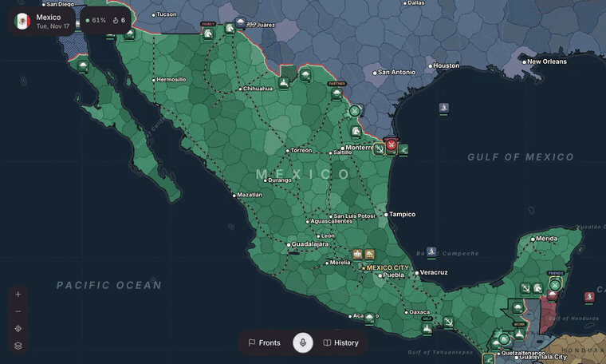
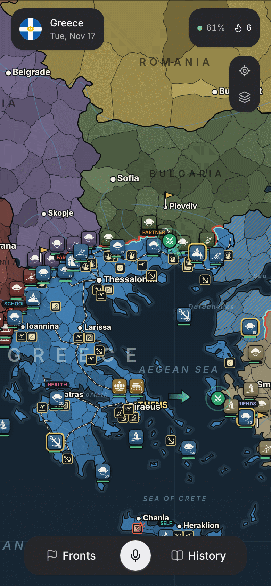
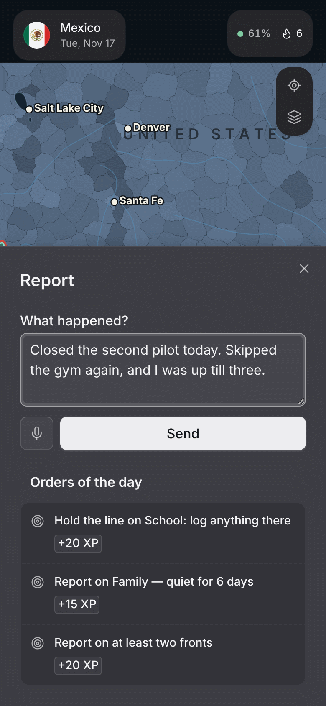
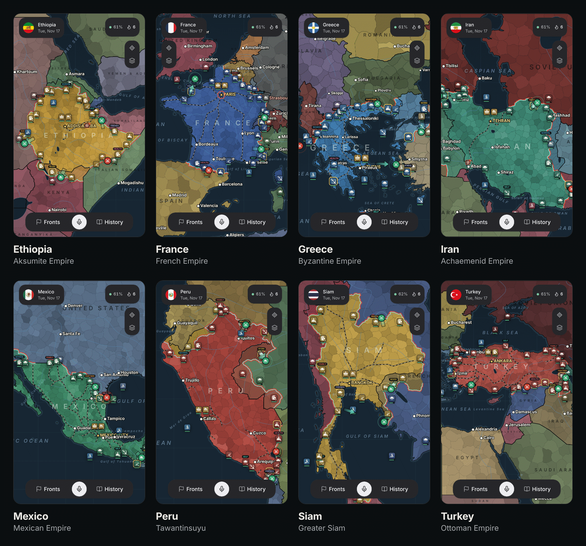
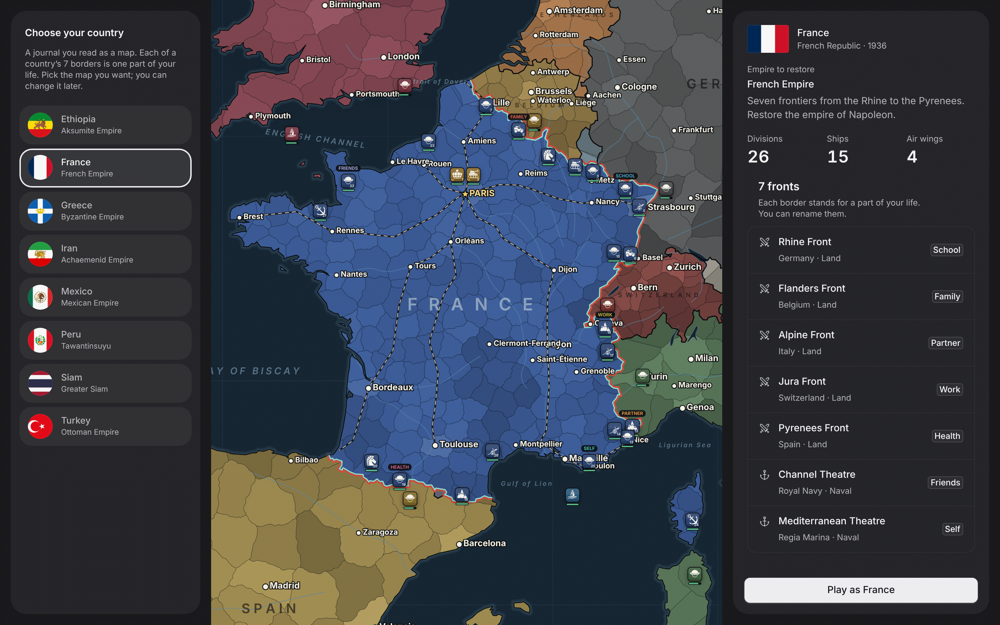
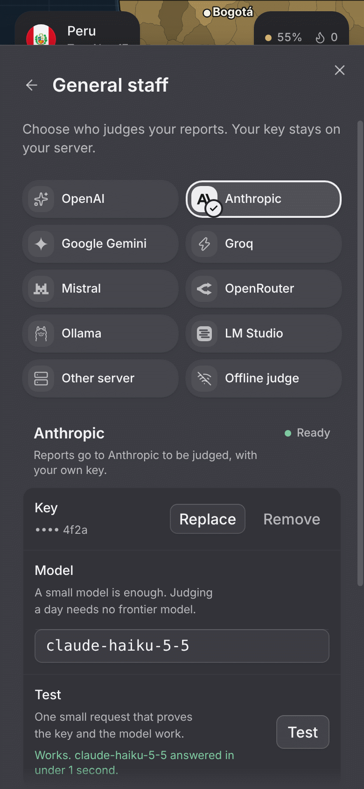

<h1 align="center">Home Front</h1>

<p align="center">
  <b>An open-source, self-hosted productivity app and daily journal that shows your whole life as a 1936 grand-strategy war map.</b><br>
  Say what happened today. It files the entry, the front lines move, and one look tells you what needs you.
</p>

<p align="center">
  <a href="https://sam-siavoshian.github.io/hoi4-irl/"><b>Try the demo</b></a> ·
  <a href="https://sam-siavoshian.github.io/hoi4-irl/how-it-works/">How it works</a> ·
  <a href="#quickstart">Quickstart</a> ·
  <a href="docs/SELF_HOSTING.md">Self-hosting</a> ·
  <a href="docs/API.md">API</a> ·
  <a href="docs/FAQ.md">FAQ</a>
</p>

<p align="center">
  <a href="https://github.com/sam-siavoshian/hoi4-irl/actions/workflows/ci.yml"></a>
  <a href="LICENSE"></a>
  
  
  
</p>

<p align="center">
  
</p>

<p align="center">
  <a href="docs/img/demo.mp4"></a>
</p>

## What it is

**Home Front is a productivity app that turns your life into a map you can read at a glance.** It is a
self-hosted habit tracker, life tracker and daily journal in one: gamified like a grand-strategy game, but
with nothing to play. It is open source (MIT), local-first (your record is a folder of plain files on your
own machine), and works with OpenAI, Anthropic, Gemini and others on your own key, with a local model in
Ollama or LM Studio, or with no model at all.

You tell it what happened today, in a sentence or two, by voice or by typing. It files that for you:
which part of your life it was about, whether it went well or badly, and how much it mattered. Then it
shows you the result as a war map. Each border of your country is one area of your life. When that
area goes well, the front line pushes outward. When you neglect it, the enemy pushes in.

So instead of charts and streak counters, you get one picture:

- School is deep in enemy territory. That is going well.
- Health has the enemy 40 km from the capital. That needs you this week.
- Friends has not moved in a month. You have not reported on it, which says something too.

Underneath the map it is a plain record. Every entry is saved with its date, what you said, how it was
judged and what it changed. You can search it, edit it, replay it from the first day, export it, and ask
questions of it ("how has work gone since September?").

It is not a game. Nothing moves unless you report something real, and there is nothing to play. The map
is there because a front line is easier to care about than a spreadsheet.

### Who it is for

- **People who quit habit trackers.** There are no forms, tags or checkboxes. One sentence a day is the
  whole input.
- **People juggling several things at once**: students with a job, founders with a family, anyone
  training for something while holding down the rest. The map shows which part is paying for the others.
- **People who like strategy games** and would rather look at a front line than a dashboard.
- **People who want their data.** It runs on your own machine, with your own key, and the record is a
  folder of plain files.

### What using it looks like

1. **Set up once.** Pick a country. Name its seven borders after the parts of your life: School, Family,
   Partner, Work, Health, Friends, Self, or whatever yours are. Pause the ones you do not need.
2. **Report once a day.** Tap the microphone and talk: *"Aced the chemistry midterm. Skipped the gym
   again. Had a fight with my brother."* That takes ten seconds.
3. **It sorts it out.** Three events: a big win for School, a small loss for Health, a loss for Family.
   Each gets a battle that fits the cause, and you can undo or correct any of them with one tap.
4. **Look at the map.** The School front advances a province. The Health front gives ground. Divisions
   gain experience or take losses. Over weeks, the shape of the front lines is the shape of your life.
5. **Look back.** History has a calendar, a weekly recap, a replay of the whole campaign and an "ask the
   staff" box that answers questions from your own entries.

### What people use it for

| You want to | How it shows up |
|---|---|
| Keep a daily journal without the blank page | One spoken sentence a day, filed and dated for you |
| See which area of life is slipping | The front where the enemy is closest to the capital |
| Stay consistent | A day streak, three small goals a day, and a front that decays if you stop reporting on it |
| Track a goal over months | A front pushing toward a named objective, city by city |
| Review your week | A weekly recap card: wins, losses, ground gained and lost per area |
| Remember what actually happened | A searchable, editable log, and answers to questions about your own history |
| Keep the data yours | Self-hosted, one password, plain files, export at any time |

The far goal is the same in every country: take every objective and the country's historical empire is
restored. Let everything slide and the capital falls. Most of life happens in between.

- **Private by design.** One user, one password, your own machine. Your API key never reaches the browser.
- **Works with any model, or none.** OpenAI, Anthropic, Gemini, Groq, Mistral, OpenRouter, Ollama, LM Studio, or the built-in offline judge. Your own key, set in the app.
- **Phone first.** Installs to the iPhone or Android home screen as a PWA and works offline.
- **Open source.** MIT licensed. The engine and server have no runtime dependencies.

More countries are on the [roadmap](#roadmap). If you would like to see them, a star on the repository helps
other people find the project.

<p align="center">
  
  
  
  
  
</p>

## Eight countries

Each has its own map, army, navy, air force, commanders, ranks and decorations, its real flag of the time, and an
empire to restore.
Change country at any time; each keeps its own campaign.

| Country | Year | Borders to restore | Fronts |
|---|---|---|---|
| Ethiopia | 1935 | Aksumite Empire | 7 land |
| France | 1936 | First French Empire (1812) | 5 land, 2 naval |
| Greece | 1936 | Byzantine Empire of Basil II | 3 land, 4 naval |
| Iran | 1936 | Achaemenid Empire | 6 land, 1 naval |
| Mexico | 1936 | Mexican Empire (1821) | 4 land, 3 naval |
| Peru | 1936 | Tawantinsuyu | 6 land, 1 naval |
| Siam | 1936 | Greater Siam | 5 land, 2 naval |
| Turkey | 1936 | Ottoman Empire | 5 land, 2 naval |

<p align="center">
  
</p>

You choose on a full-screen selection screen: the map changes behind as you browse the nations, with each
one's army, navy, air force and seven fronts laid out before you commit.

<p align="center">
  
</p>

Want another one? A country is a single file: see [docs/SCENARIOS.md](docs/SCENARIOS.md).

## How events become battles

You never choose a battle type. The staff reads the cause and picks one that fits, so the map tells you
why something happened, not just that it did:

| What you said | What the map shows |
|---|---|
| "Finished the whole problem set two days early" | An armoured breakthrough on the School front |
| "A week of flu, got nothing done" | A blizzard that closes the passes |
| "Slept through the exam after scrolling all night" | Sabotage behind your own lines |
| "A friend introduced me to an investor" | Allied aid arriving |
| "Haven't called home in three weeks" | The enemy massing on a quiet front |

## Features

**Reporting**

- Speak or type; one Send button. The staff splits a report into events, assigns fronts, dates them
  ("yesterday I...") and applies them. Undo is one tap. If it cannot tell where something belongs, it
  asks one question.
- One-tap Win / Loss on any front for days when you do not feel like writing.
- "Ask the staff": ask questions about your own history ("how has school gone since September?").

**The map**

- Seven fronts around your country, each advancing or retreating province by province, with real
  cities as objectives.
- Battle types that follow from what happened: nearly thirty of them, from Armoured Breakthrough to Desertions,
  each tied to a real-life meaning. The judge states the reason first and only then picks the type.
- Named divisions that lead battles according to their arm (armour breaks through, cavalry
  counter-attacks, artillery holds the line), gain experience, earn battle honours and nicknames, or take
  the losses.
- Geography that is respected: ports are struck only where there is a port, fleets fight only where there
  is sea. Weather follows the calendar. Three wins in a row launch a named operation; a front you stop
  reporting on lets the enemy mass.
- Regions restored under their historical names (satrapies, themes, eyalets, suyus), railways, repairs,
  new divisions and commanders, all run by the engine.

**Progress**

- Commander XP and ranks, three small "orders of the day", combos for reporting several fronts in one
  day, 30+ decorations and a weekly recap.
- History with a calendar, every entry editable or deletable, and a replay of the whole war.
- Shareable images: a daily bulletin card, a newspaper front page for big events, a weekly recap card.
- Optional sound effects, confetti, screen shake, haptics and number roll-ups. All of it can be turned
  off, and it respects the system's reduced-motion setting.

**Making it yours**

- Persona presets on first run (Student, Founder, Athlete, Creator, Parent and more) name the fronts for
  you. Everything can be renamed, and any front can be paused.
- Your own key, set in the app: OpenAI, Anthropic, Google Gemini, Groq, Mistral, OpenRouter, or a local model in
  Ollama or LM Studio, each on its small default model. With no key at all, an offline keyword judge keeps the app working.

**Running it**

- One Node server with no runtime dependencies. Also ships as a small Docker image.
- Password wall, API key kept on the host, `noindex` everywhere.
- Installs to the iPhone Home Screen and opens offline.
- A token-authenticated HTTP API and a small CLI, so iOS Shortcuts, Siri or a cron job can file a report.
- An append-only journal of every change and daily backups.

## Quickstart

You need Node 20 or newer.

```bash
git clone https://github.com/sam-siavoshian/hoi4-irl.git homefront
cd homefront
npm install               # the build tools for the interface
cp .env.example .env      # set HOMEFRONT_PASSWORD
npm start                 # builds the interface into dist/ if needed, then http://localhost:8080
```

Open the address, type the password, pick a country and a persona, and file your first report. To have a
model judge your reports, add your own key in **Settings → General staff** (or skip it: the offline judge
works with no key).

With Docker:

```bash
cp .env.example .env      # set HOMEFRONT_PASSWORD
docker compose up -d      # http://localhost:8080, data in the homefront-data volume
```

**Let your agent do it.** Give your coding agent (Claude Code, Codex, Cursor, any of them) this one line:

```text
Read https://raw.githubusercontent.com/sam-siavoshian/hoi4-irl/main/SKILL.md and set up Home Front for me.
```

[SKILL.md](SKILL.md) is a complete, self-contained setup guide written for agents. It covers a Mac mini,
a Raspberry Pi, any Linux box, Windows through WSL, Docker, and cloud hosts with a disk, and says
honestly what a static host such as Vercel can and cannot do. It installs, generates a password without
showing it, starts the server, checks it, and can add a background service, HTTPS for your phone and
backups, asking before each system change.

No API key? Add none. The offline keyword judge takes over, and you can add a key or a local model
later, in Settings, without losing anything.

Just want to look? Try the [offline demo](https://sam-siavoshian.github.io/hoi4-irl/).

## How it works

```
  you                    general staff                   engine                  map
  ───                    ─────────────                   ──────                  ───
  "aced the midterm,     for each event:                 replays every report    fronts move,
   skipped the gym"  →   front · win/loss · size 1-5  →  from the first one   →  divisions fight,
                         reason → battle type            deterministically       cities change hands
```

1. **Report.** You speak or type. Voice is transcribed on your server.
2. **Judge.** The server sends your text, the current situation and a strict JSON schema to the model.
   The model returns one item per event: which front, win or loss, a severity from 1 to 5, the reason in
   your terms, the matching battle type and a headline. Your key never leaves the host.
3. **Map.** The engine is a pure function: `state = simulate(map, reports, now)`. It replays the full
   list of reports every time, so editing or deleting an old entry rewinds history correctly, and two
   devices with the same reports always show the same war.

Nothing happens unless you report it, apart from units recovering and damage being repaired over time.
More detail in [docs/ARCHITECTURE.md](docs/ARCHITECTURE.md).

### The fronts

Every country has seven fronts, and the slots mean the same in all of them: the first is School, the fourth Work,
the last Self, whichever border it is. Two of them side by side:

| Slot | Example meaning | France | Peru |
|---|---|---|---|
| 1 | School | Rhine Front (Germany) | Zarumilla Front (Ecuador) |
| 2 | Family | Flanders Front (Belgium) | Quito Front (Ecuador) |
| 3 | Partner | Alpine Front (Italy) | Putumayo Front (Colombia) |
| 4 | Work | Jura Front (Switzerland) | Amazon Front (Brazil) |
| 5 | Health | Pyrenees Front (Spain) | Collao Front (Bolivia) |
| 6 | Friends | Channel Theatre (Royal Navy) | Tarapacá Front (Chile) |
| 7 | Self | Mediterranean Theatre (Regia Marina) | Pacific Theatre (Chilean Navy) |

The persona you pick sets the meanings; rename or pause any of them in Settings.

## Configuration

### The general staff: your own key, set in the app

The model that judges your reports is chosen in the app: **Settings → General staff**. Pick a provider,
paste your own key, and press **Test**. A first run offers the same screen as an optional step after you
choose a country. Nothing about it needs a restart.



- **The key is yours and stays on your server.** It is written to `ai.json` in the data folder
  (`~/.homefront/ai.json`, owner-only, mode `0600`) and is never sent back: the app is told only that a
  key exists, and its last 4 characters. It is not in the campaign, the journal, a backup or an export.
- **A small model is the default.** Judging a day needs no frontier model, so each provider starts on its
  small, cheap one. You can type another model name, and **Use default** puts the small one back.
- **Voice is chosen apart from the judge.** "Same as the staff" when that provider can turn speech into
  text; otherwise another provider with its own key, or "On this device" (the browser's dictation or the
  keyboard's microphone key).
- **What is set in the app wins.** `.env` remains the fallback, so an install that already has
  `OPENAI_API_KEY` in `.env` keeps working with no action. A key from `.env` shows as "set on the server":
  the app can use it, and cannot show or remove it.

| Provider | Judge (default) | Speech to text (default) | How the answer is kept to the schema | Checked against |
|---|---|---|---|---|
| OpenAI | `gpt-6-luna` | `gpt-transcribe` | Responses API, `text.format` JSON schema, strict | `gpt-6-luna` seen in [OpenRouter's live model index](https://openrouter.ai/api/v1/models) on 2026-11-16. `gpt-transcribe` **not re-checked**: OpenAI's documentation refused the fetch. Both are what the project already used. |
| Anthropic | `claude-haiku-5-5` | none | Messages API, structured outputs (`output_config.format`), low effort | Anthropic's API reference (model table dated 2026-11-03), read 2026-11-16 |
| Google Gemini | `gemini-3.5-flash-lite` | `gemini-3.5-flash-lite` (the recording goes to the model) | Interactions API, `response_format` with the JSON schema | [models](https://aistudio.google.com/docs/models), [structured output](https://aistudio.google.com/docs/structured-output), [audio](https://aistudio.google.com/docs/audio), 2026-11-16 |
| Groq | `openai/gpt-oss-20b` | `whisper-large-v3-turbo` | Chat Completions, `json_schema`, strict | [models](https://console.groq.com/docs/models), [structured outputs](https://console.groq.com/docs/structured-outputs), [speech to text](https://console.groq.com/docs/speech-to-text), 2026-11-16 |
| Mistral | `mistral-small-latest` | `voxtral-mini-latest` | Chat Completions, `json_schema`; JSON mode if refused | Ids from the examples in [Mistral's API reference](https://docs.mistral.ai/api/), 2026-11-16. **Not confirmed**: which snapshot each alias points to, and the exact `json_schema` body. |
| OpenRouter | `openai/gpt-6-luna` | none | Chat Completions, `json_schema`, strict, `provider.require_parameters` | [model index](https://openrouter.ai/api/v1/models), [structured outputs](https://openrouter.ai/docs/features/structured-outputs), 2026-11-16 |
| Ollama | `llama3.2` | none | Chat Completions, `json_schema`; JSON mode if refused | [OpenAI compatibility](https://docs.ollama.com/api/openai-compatibility), 2026-11-16 |
| LM Studio | `openai/gpt-oss-20b` | none | Chat Completions, `json_schema`; JSON mode if refused | [structured output](https://lmstudio.ai/docs/developer/openai-compat/structured-output), 2026-11-16. The default model name is a guess, **unverified**: LM Studio names a model after whatever you loaded. |
| Other server | none | none | Chat Completions, `json_schema`; JSON mode if refused | any OpenAI-compatible server |
| Offline judge | keywords, no model | this device | not a model | built in |

What "checked" means: on the date shown, the default model id, the request shape and the address were read
from the provider's own current documentation (or its live model index). **No call was made with a real key
while building this**: the test suite exercises every provider's request against local stand-ins. So a
provider can still surprise you; the Test button is the proof for your key and model. Where a provider
refuses the schema, the server asks for plain JSON instead and checks the answer itself; a bad answer falls
back to the offline judge, as any failure does.

The marks on the provider tiles are the real ones where the project may ship them (Anthropic, Google
Gemini, Mistral, OpenRouter, Ollama, LM Studio: Simple Icons, CC0). OpenAI and Groq wear a plain icon:
neither is in that set, and Groq's trademark policy does not allow its logo in an interface without a
licence. Names and logos belong to their owners.

### `.env`

The rest of the settings live in `.env` next to `server.mjs` (one `KEY=value` per line). Real environment
variables take precedence over the file.

| Variable | Default | What it does |
|---|---|---|
| `HOMEFRONT_PASSWORD` | none, required | The password you type once per device. The server refuses to start without it. |
| `HOMEFRONT_TOKEN` | empty | Bearer token for the automation API (`/api/report`, `/api/sitrep`). The API is off while this is empty. |
| `PORT` | `8080` | Port to listen on. |
| `HOST` | `0.0.0.0` | Interface to bind. Use `127.0.0.1` when a tunnel or reverse proxy sits in front. |
| `HOMEFRONT_DATA_DIR` | `~/.homefront` | Where the campaign, the provider settings and keys, sessions, journal and backups are stored. |
| `HOMEFRONT_OPEN` | unset | `1` starts the server with no login at all. Only for a machine nobody else can reach. |

The model can also be set here, as it always could. These are used while nothing is chosen in the app:

| Variable | Default | What it does |
|---|---|---|
| `OPENAI_API_KEY` | empty | Key for the judge and transcription. Empty means the offline keyword judge. |
| `OPENAI_MODEL` | `gpt-6-luna` | Model that judges reports. |
| `OPENAI_TRANSCRIBE_MODEL` | `gpt-transcribe` | Model that transcribes voice. |
| `OPENAI_BASE_URL` | `https://api.openai.com/v1` | Any OpenAI-compatible endpoint. |
| `LLM_API` | `responses` | Set to `chat` to use chat completions on servers that do not offer the Responses API. |
| `ANTHROPIC_API_KEY`, `GEMINI_API_KEY`, `GROQ_API_KEY`, `MISTRAL_API_KEY`, `OPENROUTER_API_KEY` | empty | A key for that provider kept in `.env` instead of the app. Choose the provider in Settings; the key shows as "set on the server". |
| `ANTHROPIC_BASE_URL`, `GEMINI_BASE_URL`, `GROQ_BASE_URL`, `MISTRAL_BASE_URL`, `OPENROUTER_BASE_URL` | each provider's own | Another address for that provider: a gateway or a proxy. |

## Local models

Nothing leaves your machine with a local model. In **Settings → General staff** choose **Ollama** or
**LM Studio** (or **Other server** for anything else that speaks OpenAI's Chat Completions). There is no
key. Check the address, type the name of a model you have, and press **Test**.

With [Ollama](https://ollama.com):

```bash
ollama pull llama3.2      # the small default; any model you have works
```

| Server | Address (the default in the app) |
|---|---|
| Ollama | `http://localhost:11434/v1` |
| LM Studio | `http://localhost:1234/v1` |

The same can be done in `.env`, as before the app had this screen:

```ini
# .env
HOMEFRONT_PASSWORD=choose-something-long
OPENAI_BASE_URL=http://localhost:11434/v1
OPENAI_MODEL=llama3.2
LLM_API=chat
```

Notes:

- The judge asks for JSON that matches a schema. Pick a model that handles structured output well;
  small models sometimes choose odd battle types. A server without schema support is asked for plain
  JSON, and the answer is checked on your server.
- Local servers are not used for voice: choose "On this device", or another provider, under Voice.
- Running Home Front in Docker and Ollama on the host? Use `http://host.docker.internal:11434/v1`.
- The address must start with `http://` or `https://`.

## On your iPhone

1. Put HTTPS in front of the server. The microphone and the offline mode only work over HTTPS. The
   private way is [Tailscale](https://tailscale.com): run `tailscale serve --bg 8080` on the host and you
   get an `https://<machine>.<tailnet>.ts.net` address that only your own devices can open.
2. Open that address in Safari and log in.
3. Share → **Add to Home Screen**.

It now opens full-screen like an app and keeps working without a connection. Reports made offline are
kept on the phone and synced the next time something changes while you are online.

To file a report without opening the app, see the Shortcuts and Siri recipe in [docs/API.md](docs/API.md).

## Privacy

Home Front is built for one person on a machine they control.

- **Your key stays on the host.** You paste it once in Settings; it is stored in your data folder and
  never sent back. The browser talks to your server; your server talks to the model.
- **One password, one user.** Nothing but a password box is served until you log in. The session is
  remembered per device for a year. Failed attempts are rate-limited.
- **Your data is a folder, and it is not in the repository.** The campaign, sessions, journal and backups
  live in `~/.homefront`, outside the source folder, written with owner-only permissions. `.env` is
  git-ignored, and CI fails if a data or secret file is ever committed. Back it up by copying it. Delete it and everything is gone.
- **Hidden from search engines.** Every response carries `noindex`, and `robots.txt` disallows everything.
- **No telemetry.** The server makes no network calls other than to the model endpoint you configured.

What does leave the machine: the text of your reports (and audio, if you use voice) goes to the model
provider you chose, with your own key. Use a local model or the offline judge if that matters to you. The full threat model is in
[SECURITY.md](SECURITY.md).

## FAQ

**Is it a game?**
No. It looks like one, and it borrows the pull of one, but there is nothing to play. The map only moves
when you report something real. It is a diary with consequences.

**Does it work offline?**
Yes, in two senses. Installed to the Home Screen, the app opens and accepts reports with no connection.
And with no API key at all, the offline keyword judge classifies reports on the device. It is cruder than
a model, but it works.

**Can I use my own map or country?**
Yes. Eight countries ship with it and you choose one on first run or in Settings. A new country is one
file in `tools/scenarios/`; [docs/SCENARIOS.md](docs/SCENARIOS.md) describes the format, and
`npm run build:map` turns it into a map.

**How much does it cost to run?**
One short model call per report, plus transcription if you use voice. For daily use that is very little.
With a local model or the offline judge it costs nothing.

**Can several people share one server?**
No. One server is one campaign behind one password. Run one instance per person.

More in [docs/FAQ.md](docs/FAQ.md).

## Roadmap

- More countries.
- Translations of the interface and the staff's voice.
- Import from other trackers and from plain-text journals.
- Optional encryption at rest for `~/.homefront/`.
- Reminders and notifications.
- Multiple campaigns on one server.

Ideas and pull requests are welcome; open an issue first for anything large.

## Development

```bash
npm install
npm run build        # build the interface (src/ + the vendored design system) into dist/
npm run dev          # Vite dev server on :5173 with hot reload; /api is proxied to the server on :8080
npx sam-design-check src   # the design system's check: no hand-rolled controls, colours or sizes in src/
npm test             # engine, classifier and server tests (the model API is mocked)
npm run test:e2e     # headless-browser tests at iPhone size (needs Playwright's Chromium)
npm run build:map    # regenerate data/maps/*.json and data/scenarios.json from Natural Earth + tools/scenarios/
node tools/build-icons-js.mjs   # regenerate js/icons.js from the icon sets
npm run serve        # plain static server, no login and no model: development only
```

Playwright is not a dependency. For the browser tests, run `npm i --no-save playwright` and
`npx playwright install chromium` once.

- `js/engine.js`: the deterministic war engine. The whole state is replayed from the list of reports.
- `js/map.js`: the canvas renderer. `js/classify.js`: prompts, schema and the offline judge.
  `js/voice.js`: recording. `js/store.js`: local storage and sync. `src/`: the interface (React, built into `dist/`).
- `server.mjs`: login, model proxy (`/api/llm`, `/api/transcribe`), storage (`/api/state`), automation API.
- `tools/scenarios/<country>.mjs`: cities, states, fronts, terrain, rivers, railways and every name.

## Contributing

Read [CONTRIBUTING.md](CONTRIBUTING.md) for the layout, the conventions and how to add a battle type, a
decoration or a persona. By taking part you agree to the [code of conduct](CODE_OF_CONDUCT.md). Security
problems go through [private advisories](SECURITY.md), not public issues.

## Credits

- Unit and building silhouettes: [Game-icons.net](https://game-icons.net) by Lorc, Delapouite and
  contributors, CC BY 3.0.
- Interface icons: [Lucide](https://lucide.dev), ISC licence.
- Provider marks: [Simple Icons](https://simpleicons.org), CC0. Names and logos belong to their owners and are shown to identify the service.
- Borders: [Natural Earth](https://www.naturalearthdata.com), public domain.
- Interface: React, Vite, Tailwind CSS and Base UI, through the design system in `vendor/design-system`.

Full attributions are in [NOTICE.md](NOTICE.md).

Home Front is an original project inspired by grand-strategy games such as Hearts of Iron IV. It is not
affiliated with or endorsed by Paradox Interactive, and it uses none of their code, art or data.

## Licence

[MIT](LICENSE) © 2026 Home Front contributors.
