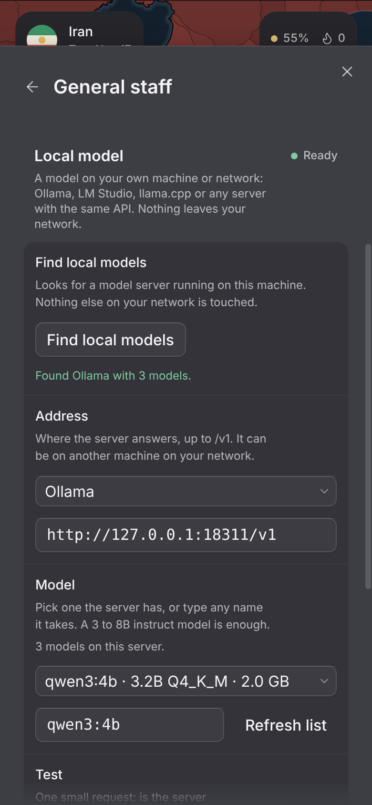

# Local models

Home Front can have every report judged by a model that runs on your own computer, or on another machine
of yours. Nothing leaves your network: no account, no key, no bill. It works with any model server that
speaks the standard OpenAI-compatible API (`/v1/models`, `/v1/chat/completions`,
`/v1/audio/transcriptions`), which is what Ollama, LM Studio, llama.cpp, vLLM, LocalAI, Jan,
text-generation-webui, KoboldCpp, MLX and llamafile all serve.



- [The short way](#the-short-way)
- [What hardware runs what](#what-hardware-runs-what)
- [From zero with Ollama](#from-zero-with-ollama) · [LM Studio](#from-zero-with-lm-studio) · [llama.cpp](#from-zero-with-llamacpp)
- [Every runtime](#every-runtime)
- [Running one specific model](#running-one-specific-model)
- [How a small model is held to the JSON](#how-a-small-model-is-held-to-the-json)
- [Advanced settings](#advanced-settings)
- [Local speech to text](#local-speech-to-text)
- [The model on another machine](#the-model-on-another-machine)
- [Docker](#docker)
- [Raspberry Pi](#raspberry-pi)
- [Troubleshooting](#troubleshooting)
- [Setting it in `.env` instead](#setting-it-in-env-instead)
- [What was verified](#what-was-verified)

## The short way

1. Start a model server and give it a model (below: [Ollama](#from-zero-with-ollama),
   [LM Studio](#from-zero-with-lm-studio), [llama.cpp](#from-zero-with-llamacpp)).
2. In Home Front open **Settings → General staff → Local model** and press **Find local models**. The
   server looks for a model server on this machine and says, for example, "Found Ollama with 3 models."
3. Pick a model from the list, or type any name the server takes, and press **Test**.

That is all. "Ready" in Settings means reports now go to that model. Everything else is under
**Advanced** and has a safe default.

**Find local models touches this machine only.** It knocks once on each runtime's well-known port
(11434, 1234, 9931, 8080, 8000, 1337, 5000, 5001) on `127.0.0.1` and on `host.docker.internal` (the
computer a Docker container runs on), with a short timeout. It never scans your network. A model on
another machine is added by typing its address.

## What hardware runs what

A model's size in memory is roughly its parameter count times the bytes per weight. Local runtimes use
4-bit quantised files (`Q4_K_M` is the common choice), about 0.6 GB per billion parameters, plus room for
the context. As a rule of thumb, leave a few GB for the system and the app.

| Memory (RAM, or VRAM on a graphics card, or unified memory on Apple silicon) | What fits comfortably at 4-bit |
|---|---|
| 8 GB | 1 to 4 billion parameters. A 7 or 8B model loads, but leaves little for anything else. |
| 16 GB | 7 to 8B with room to spare; up to about 14B. |
| 32 GB | Up to about 30B. |

**Judging a day needs a small model.** The job is to read a few sentences and fill in a short form: which
part of your life, a win or a loss, how big, which battle type. A **3 to 8B instruct model** is enough.
Models under about 2B do answer, and Home Front reads their answers, but they pick odd fronts and battle
types more often. Bigger models judge a little better and answer more slowly.

Speed matters less than you might think: you file a report or two a day. A graphics card or Apple silicon
answers in seconds; a CPU alone can take a minute or more, which is fine for this, if the timeout allows
it (the default waits 180 seconds). "Reasoning" models that think before they answer (they write a
`<think>` block) are slower; the thinking is dropped and only the answer is read.

## From zero with Ollama

1. Install it from [ollama.com/download](https://ollama.com/download). On macOS and Windows it runs in the
   menu bar; on Linux the installer sets up a service. It listens on `http://127.0.0.1:11434`.
2. Pull a small instruct model:

   ```bash
   ollama pull llama3.2        # 3B
   ollama list                 # what you have
   ```
3. In Home Front: **Settings → General staff → Local model → Find local models**. It says "Found Ollama
   with 1 model" and picks it. Press **Test**: it says "Works", how long the model took, and how it was
   held to the JSON.
4. File a report. The map moves with the model's judgement; if the model ever fails, the offline judge
   takes that report instead and says so.

Ollama loads a model when it is first asked and unloads it after 5 minutes. To keep it loaded (faster
first answers), set **Keep the model loaded for** under Advanced, for example `1h`, or `-1` for always.
Ollama's default context is 4096 tokens, which is enough for a report; **Context length** under Advanced
raises it per request.

## From zero with LM Studio

1. Install it from [lmstudio.ai/download](https://lmstudio.ai/download).
2. Download a model in the app (Discover), or from a terminal:

   ```bash
   lms get llama-3.1-8b               # the example in LM Studio's docs; @q4_k_m picks a quantisation
   lms load llama-3.1-8b
   lms server start                   # or Developer tab → Start server
   ```
3. The server is at `http://127.0.0.1:1234/v1`. In Home Front press **Find local models**, pick the model
   that is loaded, and **Test**.

LM Studio names a model after the file you loaded; the list in Home Front shows exactly those names.
LM Studio's own documentation warns that not every model handles structured output, "particularly LLMs
below 7B"; Home Front then falls back on its own ([below](#how-a-small-model-is-held-to-the-json)).

## From zero with llama.cpp

1. Get `llama-server`: a release build from
   [github.com/ggml-org/llama.cpp/releases](https://github.com/ggml-org/llama.cpp/releases), Homebrew
   (`brew install llama.cpp`), or build it.
2. Start it with a model straight from Hugging Face, or with a GGUF file you have:

   ```bash
   llama-server -hf ggml-org/gemma-3-4b-it-GGUF          # an example repository; :Q4_K_M is the default quant
   llama-server -m ~/models/My-Model-Q4_K_M.gguf -c 8192
   ```
3. It listens on `127.0.0.1:9931` by default (older builds and its Docker examples use 8080; Home Front
   looks at both). Press **Find local models**: "Found llama.cpp with 1 model." **Test**: llama.cpp also
   reports its speed, so the line says how many tokens a second it wrote.

`llama-server` holds the model to the JSON schema with a grammar, so even a small model gives valid JSON.
Started with `--api-key`, it wants that key: add it under **Advanced → Key**.

## Every runtime

The presets fill in the address; you can always type any `http://` or `https://` address instead.
"Structured output" is what the runtime's documentation promises; whatever it promises, Home Front tries
the strictest way first and steps down by itself when refused.

| Runtime | Default address | Structured output | Speech to text | Documentation (read 2026-11-17) |
|---|---|---|---|---|
| Ollama | `http://127.0.0.1:11434/v1` | `response_format` (JSON schema; JSON mode); with a context length or keep-alive set, its own `/api/chat` with `format` set to the schema | `/v1/audio/transcriptions`, WAV, with a model that takes audio | [OpenAI compatibility](https://docs.ollama.com/api/openai-compatibility), [chat](https://docs.ollama.com/api/chat), [tags](https://docs.ollama.com/api/tags) |
| LM Studio | `http://127.0.0.1:1234/v1` | `json_schema` (grammar for GGUF, Outlines for MLX) | not listed | [OpenAI compatibility](https://lmstudio.ai/docs/developer/openai-compat), [structured output](https://lmstudio.ai/docs/developer/openai-compat/structured-output) |
| llama.cpp `llama-server` | `http://127.0.0.1:9931/v1` (also 8080) | `json_schema` and JSON mode, grammar-enforced | no HTTP transcription endpoint | [server README](https://github.com/ggml-org/llama.cpp/blob/master/tools/server/README.md) |
| vLLM | `http://127.0.0.1:8000/v1` (the address its examples use) | `json_schema` | `/v1/audio/transcriptions` with a speech model | [OpenAI-compatible server](https://github.com/vllm-project/vllm/blob/main/docs/serving/online_serving/openai_compatible_server.md), [structured outputs](https://github.com/vllm-project/vllm/blob/main/docs/features/structured_outputs.md) |
| LocalAI | `http://127.0.0.1:8080/v1` | not confirmed: negotiated | `/v1/audio/transcriptions` with a whisper model | [quickstart](https://localai.io/docs/start/quickstart/), [audio to text](https://localai.io/docs/models/capabilities/audio/audio-to-text/) |
| Jan | `http://127.0.0.1:1337/v1` | not documented: negotiated | not documented | [local API server](https://docs.jan.ai/desktop/api-server) |
| text-generation-webui | `http://127.0.0.1:5000/v1` (started with `--api`) | not documented: negotiated | `/v1/audio/*` "supported" | [OpenAI API](https://github.com/oobabooga/text-generation-webui/blob/main/docs/12%20-%20OpenAI%20API.md) |
| KoboldCpp | `http://127.0.0.1:5001/v1` | GBNF grammars on its own API; `json_schema` not documented: negotiated | `/v1/audio/transcriptions` with `--whispermodel`, WAV | [wiki](https://github.com/LostRuins/koboldcpp/wiki) |
| MLX (`mlx_lm.server`) | `http://127.0.0.1:8080/v1` | not documented: expect plain text | none | [SERVER.md](https://github.com/ml-explore/mlx-lm/blob/main/mlx_lm/SERVER.md) |
| llamafile | `http://127.0.0.1:8080/v1` | as the llama.cpp it bundles | `/v1/audio/transcriptions` with a compatible model | [API server](https://docs.mozilla.ai/llamafile/using-llamafile/api.md) |
| Another server | the address you type | negotiated | negotiated | |

LocalAI, MLX and llamafile share port 8080 with older llama.cpp builds, so discovery reports a server on
8080 by what it says about itself, or as "a model server on port 8080". Pick the preset that matches, so
that a missing model is answered with that runtime's own install command.

Only Ollama was run for real while building this (see
[What was verified](#what-was-verified)); every other line is from the documentation linked, and the
tests use stand-ins for each kind of behaviour.

## Running one specific model

The model field takes **any name the server understands**, not only what is in its list: a tag, a
Hugging Face repository, a file path. Home Front says when what you typed is not in the server's list, and
gives the command that would get it; **Test** says for sure.

| Runtime | How to get a particular model |
|---|---|
| Ollama | `ollama pull qwen3:8b` (any tag from [ollama.com/library](https://ollama.com/library)); any GGUF on Hugging Face: `ollama pull hf.co/{user}/{repo}:{quant}`, for example `hf.co/bartowski/Llama-3.2-3B-Instruct-GGUF:Q4_K_M` ([Hugging Face's guide](https://huggingface.co/docs/hub/ollama)). Type the same name in Home Front. |
| LM Studio | `lms get <name>`, or `lms get <name>@q4_k_m` for one quantisation; `lms load <name>`. |
| llama.cpp | `llama-server -hf {user}/{repo}:{quant}` or `llama-server -m /path/to/model.gguf`. The server has one model; the name you type is not used to choose it. |
| vLLM | `vllm serve {user}/{repo}`; type the same repository name. |
| MLX | `mlx_lm.server --model mlx-community/...`; type the same. |
| LocalAI | `local-ai run <model>` or `local-ai models install <name>`. |
| KoboldCpp, llamafile, Jan, text-generation-webui | load the model in the server itself; type the name it lists. |

## How a small model is held to the JSON

Every report is judged into a strict JSON shape. Big cloud models follow a schema without trouble; small
local ones sometimes do not. For a local server Home Front asks in the strongest way the server takes,
and **remembers what worked for that address and model**:

1. **Strict schema**: `response_format` of type `json_schema`. Servers with grammars (llama.cpp, LM
   Studio, vLLM, Ollama) then cannot produce anything else.
2. **JSON mode**: `response_format` of type `json_object`, with the schema written into the prompt.
3. **Plain text**: no `response_format` at all, the schema in the prompt, and the first JSON object dug
   out of whatever comes back: after a `<think>…</think>` block, inside a code fence, or in the middle
   of a sentence.

The answer is then checked against the shape. What can be mended safely is mended (a number sent as
text, a severity outside 1 to 5, a battle type in capitals, extra fields); an unknown front or battle type
is dropped or replaced by the plain one, as for any provider. If something is still wrong, the model is
asked once more, with what was wrong said back to it. If that fails too, that report is judged by the
offline keyword judge, and the app says so. Temperature is 0, so the same report is judged the same way.

## Advanced settings

Under **Advanced** in the Local model section. Empty means the default.

| Setting | Default | What it does |
|---|---|---|
| Key, if the server needs one | none | Sent as `Authorization: Bearer`. For servers started with a key: `llama-server --api-key`, `vllm serve --api-key`, `LOCALAI_API_KEY`, Jan, KoboldCpp's `--password`. Stored like any key (owner-only, never sent back). |
| Wait for an answer, in seconds | 180 | Local models load into memory before their first answer. Raise it on a slow machine. |
| Ask for JSON | Automatic | Fix one of the three ways above instead of letting Home Front find out. |
| Most tokens to write | the server's | `max_tokens`. A judgement needs a few hundred. Set it if your server's default is very low. |
| Temperature | 0 | 0 is the most repeatable. |
| Context length, in tokens | the model's | Ollama only (other servers take it when they start, such as `llama-server -c 8192`). |
| Keep the model loaded for | Ollama's (5 minutes) | Ollama only: `10m`, `1h`, `-1` for always, `0` to unload at once. |

## Local speech to text

Voice can stay on your network too. Under **Voice → Speech to text** choose **Local speech server**, pick
the kind of server, check the address and the model, and press **Test** (it sends half a second of
silence). Any server that takes `POST /v1/audio/transcriptions` the way OpenAI's API does will work.

| Server | Default address | Model name | Get started (read 2026-11-17) |
|---|---|---|---|
| [Speaches](https://speaches.ai/) (formerly faster-whisper-server) | `http://127.0.0.1:8000/v1` | `Systran/faster-distil-whisper-small.en` | `uvx speaches-cli model download Systran/faster-distil-whisper-small.en` ([speech to text](https://speaches.ai/usage/speech-to-text/)) |
| [whisper.cpp server](https://github.com/ggml-org/whisper.cpp/tree/master/examples/server) | `http://127.0.0.1:8080/v1` | ignored: the file it was started with | `whisper-server -m models/ggml-base.en.bin --inference-path /v1/audio/transcriptions` (its own default path is `/inference`). WAV only, unless started with `--convert` |
| [LocalAI](https://localai.io/docs/models/capabilities/audio/audio-to-text/) | `http://127.0.0.1:8080/v1` | `whisper-1` (the name in its YAML file) | put a whisper model in its models folder with a YAML file |
| Ollama | `http://127.0.0.1:11434/v1` | a model that takes audio | WAV only |
| [KoboldCpp](https://github.com/LostRuins/koboldcpp/wiki) | `http://127.0.0.1:5001/v1` | ignored: the file given with `--whispermodel` | `koboldcpp --whispermodel <whisper .bin>`. WAV only |
| vLLM | `http://127.0.0.1:8000/v1` | the speech model it serves | `vllm serve <speech model>` |

For a server that takes WAV only (whisper.cpp, Ollama, KoboldCpp), the app converts the recording to
16 kHz mono WAV in the browser before it is sent. The model field is editable for every provider, cloud
ones included: **Use default** puts the small one back.

## The model on another machine

A desktop with a graphics card can judge for a Home Front that runs on a small server, a Raspberry Pi or
a laptop. Type that machine's address in **Address**: `http://192.168.1.20:11434/v1` on your home
network, or its tailnet name, `http://gpu-box:11434/v1` with Tailscale MagicDNS.

The model server must listen on more than its own loopback:

- Ollama: set `OLLAMA_HOST=0.0.0.0:11434` for the service, then restart it
  ([Ollama FAQ](https://docs.ollama.com/faq)).
- LM Studio: turn on serving on the local network in the server settings.
- llama.cpp: `llama-server --host 0.0.0.0 ...`.

These servers usually have no password. Expose them on a tailnet or your home network only, never to the
internet; start them with a key where they offer one, and add it under Advanced. **Find local models**
will not find another machine: it looks on this one only.

## Docker

Inside a container, `127.0.0.1` is the container itself. A model server on the computer that runs Docker
is at `host.docker.internal`; **Find local models** looks there too.

- Docker Desktop (macOS, Windows) provides `host.docker.internal` as is.
- On Linux the bundled `docker-compose.yml` maps it with `extra_hosts: host.docker.internal:host-gateway`.
  With `docker run`, add `--add-host=host.docker.internal:host-gateway`.
- On Linux the model server must also accept connections from the Docker bridge, not only from
  `127.0.0.1`: for Ollama, `OLLAMA_HOST=0.0.0.0:11434` (and keep the port closed to the outside with your
  firewall).

The address is then `http://host.docker.internal:11434/v1` (or that runtime's port).

## Raspberry Pi

Home Front itself runs well on a Raspberry Pi. A model on the Pi is possible and slow: a Pi 5 with 8 or
16 GB can run a 1 to 3B model on its CPU, and a judgement can take a minute or more. Raise **Wait for an
answer** to 300 seconds or more and keep the model loaded. The better arrangement is usually Home Front on
the Pi and the model on a desktop or laptop on the same network ([above](#the-model-on-another-machine)).

## Troubleshooting

**Test** says which part is wrong:

| Test says | What to do |
|---|---|
| "Nothing answered at 127.0.0.1:11434. Check that Ollama is running." | Start the server. In Docker, use the `host.docker.internal` address it suggests. |
| "Couldn't reach 192.168.1.20:11434. Check that … it listens on that address and not only on its own loopback …" | The model server is bound to `127.0.0.1` on that machine, or a firewall blocks the port. See [another machine](#the-model-on-another-machine). |
| "Something answered at …, but not with the OpenAI-compatible API." | The address is wrong, most often a missing `/v1` at the end. |
| "The server answered, but it has no model called qwen3:8b. Run ollama pull qwen3:8b, or pick one from the list." | Pull or load it with the command shown, or pick an installed model. |
| "… answered, but not with JSON that could be used." | The model is too small or not an instruct model. Try a 3 to 8B instruct model, or another way under **Ask for JSON**. |
| "… ran out of room before it finished." | Raise **Most tokens to write**, or the context length. |
| "… took longer than 180 seconds." | The first answer after loading is the slowest. Try again, raise the timeout, or keep the model loaded. |
| "The server wants a key, or refused the one it was given." | Add the key the server was started with under Advanced. |

Settings shows **Model server not running** (not "No key") when the last attempt could not reach the
server. A report filed meanwhile is judged by the offline judge, so nothing is lost.

## Setting it in `.env` instead

What is set in the app wins; these are the fallback for a server set up from files.

| Variable | What it does |
|---|---|
| `LOCAL_BASE_URL` | The model server's address. With `LOCAL_MODEL`, turns the local model on when nothing is chosen in the app. |
| `LOCAL_MODEL` | The model's name. |
| `LOCAL_API_KEY` | A key, for a server that needs one. |
| `LOCAL_TIMEOUT_MS` | How long to wait for a local model, in milliseconds (default 180000). |
| `LOCAL_STT_BASE_URL`, `LOCAL_STT_MODEL` | A local speech-to-text server and its model. |

The older way, `OPENAI_BASE_URL=http://localhost:11434/v1` with `LLM_API=chat` and `OPENAI_MODEL`, still
works and is treated as a local model too.

## What was verified

On 2026-11-17, in a 4-core Linux VM with no graphics card: Ollama 0.40.16 with `qwen3:0.6b`. **Find local
models** found it, the model list showed its size and quantisation, **Test** passed with the strict
schema, a missing model got the `ollama pull` line, and two reports were judged through it end to end.
The 0.6B model's judgements were poor (wrong fronts), which is why this guide recommends 3 to 8B, and each
took one to two minutes on that CPU with the model's thinking on. The other runtimes were not run: their
lines come from their documentation, and the test suite covers each behaviour (strict schema, JSON mode
only, prose with a thinking block, Ollama's own API, a key, a missing model, an unreachable address, a
speech server) with stand-ins.
